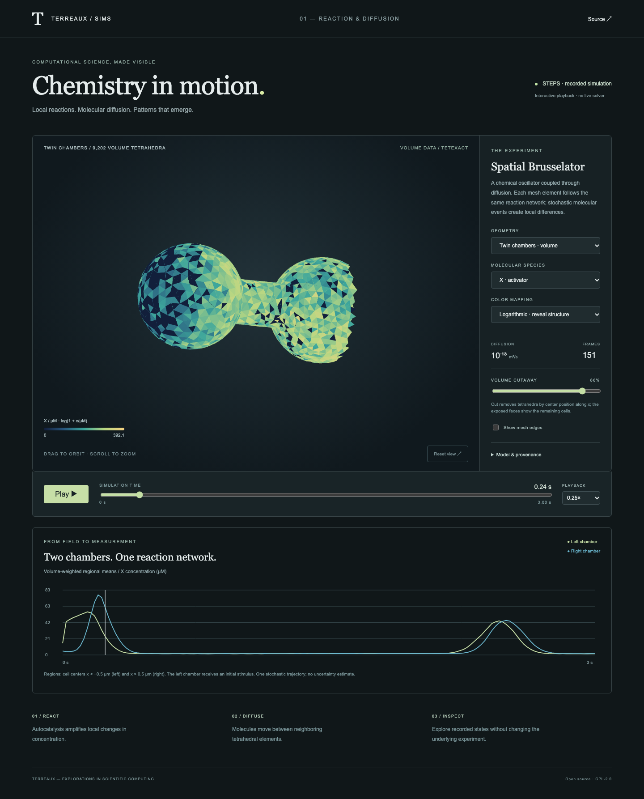

# Chemical Waves · Terreaux Sims

A 3D reaction–diffusion experiment with real [STEPS](https://steps.sourceforge.net/)
data, an original closed surface tetrahedralized into a volume, and an interactive
WebGL viewer. Open source under GPL-2.0-only.

Three geometries are available: a conceptual **engine interior** with twelve
stator vanes and six bypass passages, the original twin chambers, and the
official STEPS slab. The engine is an idealized sealed microscale cavity for
chemical reaction–diffusion; no airflow, combustion or engine performance is
simulated. [Geometry, methods and limitations](docs/engine.md).



A [10-second engine activator orbit](media/preview.html) is available as
[MP4](media/engine-activator-orbit.mp4) and [WebM](media/engine-activator-orbit.webm),
with a poster and [website embed instructions](media/README.md). It uses actual
recorded X concentrations and keeps its scientific scope visible on screen.

## View locally

```sh
python3 -m http.server 8765 --bind 127.0.0.1
```

Open <http://127.0.0.1:8765>. Playback needs a modern browser with WebGL. There is
no frontend build, CDN, analytics, API key or paid service. The viewer loads the
bundled recordings, so **STEPS is not required to view them**.

On macOS, run `python3 scripts/local_preview.py start` for a background preview
at <http://127.0.0.1:8766/> that lasts until logout or restart. It stages public
assets in `/tmp`, loads a session launchd service, and installs no login item.
Run `start` again to refresh the staged site after changing source files, or
`python3 scripts/local_preview.py stop` to stop it.

Drag to orbit, scroll to zoom, select X or Y, scrub time, play/pause, toggle mesh
edges and use the volume cutaway. Keyboard: focus the canvas and use arrow keys
to rotate or Space to play/pause. Each species uses a fixed color range across
all recorded times. The custom volume includes synchronized volume-weighted
regional concentration traces.

The default logarithmic color mapping reveals structure across the wide
concentration range. Its `log(1 + c/µM)` transform is labeled in the legend;
switch to linear mapping for proportional colors. Neither changes stored values.
Three-quarter, axial and interior camera presets help inspect the engine.
Sections can run along x, y or z. Optional depth shading can be disabled to view
the exact unshaded color transfer function.
The engine initially uses a labeled 99.5th-percentile color range, saturating
rare peaks. Full-range logarithmic and linear mappings remain available. Gray
core and vane geometry is a toggleable solid-context overlay, not chemical data.

**This is interactive playback, not a live solver.** Camera and display controls
do not change the chemical trajectory. The official slab dataset is a surface
extraction; the custom twin-chamber recording contains per-tetrahedron volume
data. Its cutaway removes complete tetrahedra and exposes their faces.

## Reproduce the pipeline

Python 3.12 is the tested authoring environment. Start with a virtual environment:

```sh
python3.12 -m venv .venv
.venv/bin/pip install -r requirements.txt
.venv/bin/python scripts/build_volume.py
.venv/bin/python scripts/simulate_volume.py
.venv/bin/python scripts/convert_recording.py
# Additional engine interior:
.venv/bin/python scripts/build_engine.py
.venv/bin/python scripts/simulate_volume.py --preset engine
```

`build_volume.py` creates two chambers joined by a neck, exports a closed STL,
imports that surface into a fresh Gmsh model, tetrahedralizes the interior, then
checks connectivity, watertightness, element volumes, quality and geometric
volume error. The STL and resulting Gmsh 2.2 tetrahedral mesh are committed.
This original synthetic surface avoids uncertainty about third-party asset
licenses. Replace it with an appropriately licensed closed surface in a later
experiment only after validating it.

The physical simulation is half the mesh source scale: `scale=5e-7` meters per
mesh coordinate, giving a roughly 3.2 µm long domain. `simulate_volume.py` runs
STEPS' serial stochastic `Tetexact` solver, seed 1234. Its initial X stimulus,
rate constants, mesh hash, STEPS version and timings are recorded in the source
and `volume/manifest.json`. Save interval is 0.02 s, duration 3 s.

On the tested Apple Silicon machine, STEPS 5.1.0 required a serial build and a
compiler compatibility flag. To build that configuration with `uv`:

```sh
CMAKE_ARGS='-DUSE_PETSC=OFF -DUSE_MPI=OFF -DSTEPS_USE_DIST_MESH=OFF -DSTEPS_USE_STEPSBLENDER=OFF -DCMAKE_CXX_FLAGS=-Wno-invalid-specialization\ -g0' \
CMAKE_BUILD_PARALLEL_LEVEL=4 uv pip install --python .venv/bin/python steps==5.1.0
```

`-g0` avoids generating large debug symbols. The compatibility flag suppresses
the compiler diagnostic for an upstream C++ standard-trait specialization;
no STEPS source was edited. A compiled C++ toolchain and native prerequisites
are necessary if a compatible wheel is unavailable. See the
[STEPS installation documentation](https://steps.sourceforge.net/manual/installation.html).

## Validate

```sh
python3 -m unittest discover -s tests -v
.venv/bin/python -m playwright install chromium
# With the localhost server running:
SIMS_URL=http://127.0.0.1:8765/ .venv/bin/python tests/browser.py
```

The conversion test checks every displayed baseline concentration against its
original archived float64 value, including units and frame order. Mesh reports
and custom recording dimensions, nonnegative values and mesh hashes are checked.
Browser checks exercise time, species, playback, orbit, cutaway, baseline
switching and mobile layout, and save a preview to `docs/preview.png`.

Mesh quality is an initial engineering check. Spatial/time convergence,
ensemble statistics and comparative solver validation remain future work.
This single trajectory is a demonstration of a synthetic chemical oscillator,
not a validated biological prediction.

## Sources and license

The baseline mesh, example script and published recording come from
[CNS-OIST/STEPS_Example](https://github.com/CNS-OIST/STEPS_Example), pinned at
`23d8e941fcdd3e8d64e0764233b81746671600ab`. The upstream repository declares
GPL-2.0; its full license is retained. The custom simulation script adapts its
spatial Brusselator model. Terreaux's viewer, mesh generator and original
geometry are released under GPL-2.0-only as well.

Read [provenance and scientific limitations](docs/provenance.md) for exact
upstream paths, hashes, units, conversion rules and interpretation. The
[initial design](docs/design.md) records the scope of the first vertical slice.

No hosting deployment is configured. Serve the files locally to explore them.
