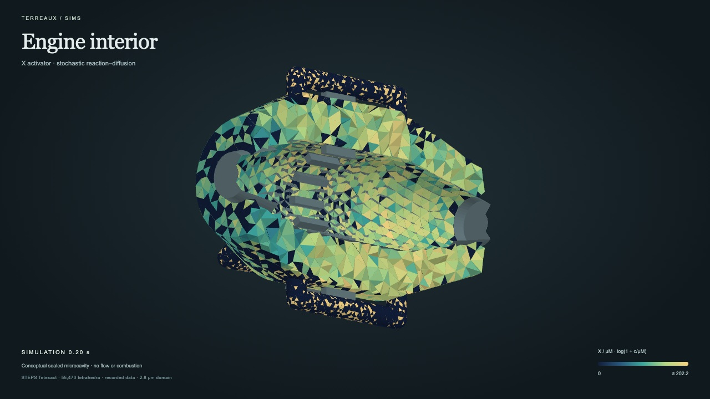

# Engine activator: ten-second simulation and bounce loop

Website-ready video of the actual STEPS X-activator recording in the conceptual
engine cavity. The real simulation runs from **0 to 10 seconds** and saves
**251 states every 0.04 seconds**. The forward video shows that interval over
ten seconds while the camera makes one 360° orbit with gentle pitch variation.

For the site, use **`engine-activator-bounce.mp4` or `.webm`**: a 20-second loop
containing the 10-second forward clip followed by 10 seconds of reverse playback.
Both halves have explicit direction labels. The same camera orbit returns to its
starting point; the chemistry is never solved backward.

- `engine-activator-orbit.mp4`: H.264, 1280 × 720, 30 fps, 10 seconds, no audio,
  with fast-start metadata for web playback.
- `engine-activator-orbit.webm`: VP9 alternative.
- `engine-activator-bounce.mp4` / `.webm`: recommended forward/reverse site loop,
  1280 × 720, 30 fps, exactly 20 seconds, no audio.
- `engine-activator-orbit-poster.jpg`: still fallback/preview.
- `orbit-export.json`: source hash, encoding measurements, sampling and checksums.

Concentrations hold at their recorded 0.04-second samples; no concentrations are
interpolated. Camera motion is sampled at 30 fps. Bounce frame order is forward
0…299, then 299…0, with one repeated endpoint frame at each turnaround. The
reverse half is a visual replay of the same finite trajectory, not reverse
chemical dynamics or a claim that the chemical solution is periodic.

Colors represent X concentration in µM with a fixed logarithmic transfer
function and the labeled global 99.5th-percentile range. Rarer peaks share the
top color. Gray hardware is solid context, not chemical concentration. The
on-screen scope is retained: an idealized sealed microscopic cavity, with no
flow, combustion or engine-performance calculation.

## Embed

Copy the video and poster assets to your site's media folder, then adapt paths:

```html
<video width="1280" height="720" autoplay muted loop playsinline controls
       preload="metadata" poster="/media/engine-activator-orbit-poster.jpg"
       aria-label="Recorded X activator in an idealized sealed engine-shaped microcavity">
  <source src="/media/engine-activator-bounce.webm" type="video/webm">
  <source src="/media/engine-activator-bounce.mp4" type="video/mp4">
  
</video>
<script>
  const video = document.querySelector('video');
  if (matchMedia('(prefers-reduced-motion: reduce)').matches) {
    video.autoplay = false;
    video.pause();
  }
</script>
```

Keep a way to pause the animation. The poster also works as a static alternative.
See `preview.html` for a local playback page. No website hosting is deployed by
this repository.
Use a static host with HTTP byte-range support for reliable seeking. The basic
Python development server can play the file but does not implement those ranges.

## Reproduce

The renderer starts a scoped temporary localhost server and closes it afterward:

```sh
.venv/bin/python scripts/simulate_volume.py --preset engine --duration 10
.venv/bin/python scripts/export_orbit.py --duration 10 --fps 30
.venv/bin/python scripts/export_bounce.py
```

Requires the pinned Playwright environment, Chromium and FFmpeg with libx264 and
libvpx-vp9. Bounce labels use Pillow and the system Helvetica font. Export uses the same WebGL renderer as interactive playback through
the `?capture=1` presentation mode. The capture mode is separate from ordinary
interactive viewing.

Original Terreaux geometry, visualization and video are released under
GPL-2.0-only. The chemistry adapts the CNS-OIST GPL-2.0 spatial Brusselator example;
see [provenance](../docs/provenance.md) and [engine methods](../docs/engine.md).
